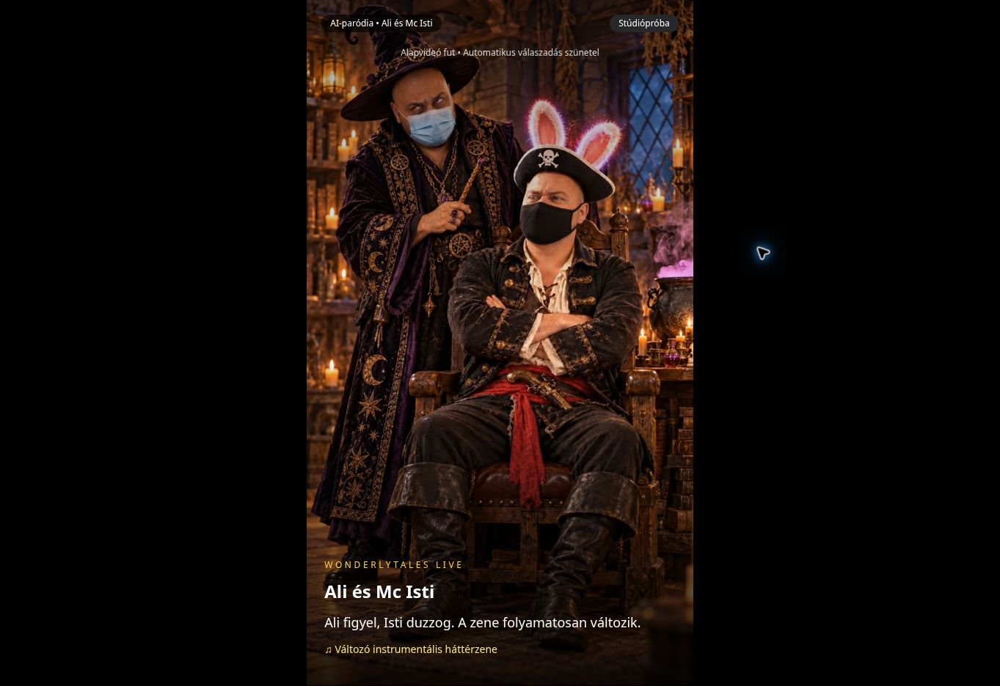

# NPC-műsor: éles ellenőrzés, 2026-10-14

Ellenőrzött alkalmazás: https://wonderlytales.vercel.app/live-studio
Ellenőrzött kód: `caa05c2c1ff27ee7f19dbf9120f1b6d0ac0abffd`.

## Eredmény

- Mindhárom 720×1280-as, 8 másodperces alapmozgás elkészült. A képkockákon a maszkok épek; a finom mozdulatok közös nyugalmi pózba térnek vissza. A lejátszó a következő jelenetet előre betölti, az előző záróképét az indulásig megtartja.
- A javított 12 másodperces ajándékreakció képkocka-ellenőrzésen megfelelt: felállás → álló gesztikulálás → visszaülés. Mindkét arcmaszk végig ép. Az első, hibás 8 másodperces változat nincs használatban.
- A mentett kiabálás 2,847 másodperces. Helyi beszédfelismerés a kért mondatot adta vissza: „Ne dobd azt a szart, a kurva anyád!” A hang az álló rész alatt, 4,2 másodpercnél indul.
- Az éles felület automata próbája egy kommentre friss Ali–Isti párbeszédet, majd a Zene próbaajándékra a mentett kiabálós reakciót játszotta. A felület 2 befejezett választ, 0 várakozót és sikeres próbabefejezést jelzett, majd minden média megállt.
- A kommentválasz alatt a DOM-ban a tényleges ElevenLabs hangelem `paused=false`, `muted=false`, `readyState=4` állapotban haladt; mellette az NPC-videó is játszott. Új beszélő Runway-videó nem indult.
- A költségnapló a próba után is 4 darab 8 másodperces és 3 darab 4 másodperces NPC-foglalást tartalmazott. A próba nem indított további videógenerálást. Az előkészítés összes videóköltség-foglalása a hibás első változattal együtt 4,40 USD; az ismételt lejátszás a már mentett fájlokat használja.
- 32 célzott teszt sikeres; TypeScript és production build sikeres. A három videórész éles szerveren történő összefűzése és tartós tárolása is működött.

## Indítás

Az elkészült fájlokat nem kell újra generálni. Az **Automata műsorpróba – komment + ajándék** TikTok nélkül ellenőrizhető. Saját LIVE alatt a felhasználónév megadása után az **Automata műsor indítása** indítja a képet, zenét és válaszsort.

A zenés ajándék pontos TikTok-azonosítója még nincs megadva. A jelenlegi pontos névlistát a ténylegesen beérkező ajándék alapján lehet véglegesíteni; a felület a naplóban megjelent ajándékot egy gombbal kiválasztja. A böngészős próba nem igazolja a felhasználó telefonjának TikTok-képméretét és rendszerhang-továbbítását.

