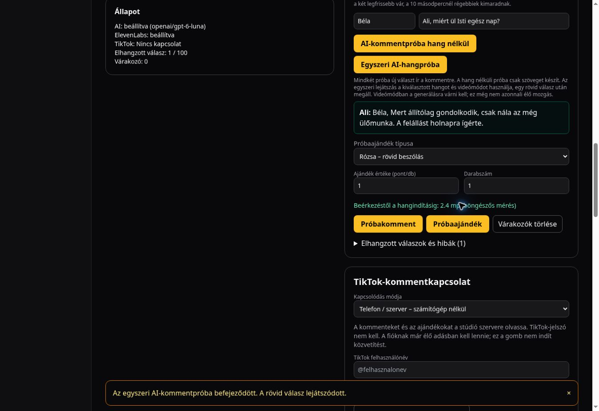

# Direct PCM live speech

The 2026-10-14 continuation starts from production commit `74cb7cf`.
A fresh browser baseline at 10:00 UTC on that deployment reported **2.5 seconds** from the
comment test to playback for “Ali, miért ül Isti egész nap?”. This is a browser
measurement, not phone-to-TikTok-to-viewer latency. The matching server trace
reported first sentence at 1,276 ms and first audio bytes at 1,438 ms.

## Change

Clients that successfully unlock Web Audio request `X-Live-Audio-Format: pcm`.
The authenticated respond route uses the same model, voice, complete-sentence
validation and paid session as before, requesting ElevenLabs `pcm_24000`.
The streamed response explicitly declares its negotiated format. The browser
schedules signed 16-bit little-endian samples directly into its running audio
context, starting with a 40 ms safety buffer. It no longer waits for the media
element's MP3 decoder to buffer enough content.

Fresh gift speech uses the same optional format. Saved gift videos and recorded
voices keep their existing playback path. Clients without a running audio
context, including older clients, continue to receive MP3. No second paid
generation is attempted if a stream fails.

PCM chunks preserve sample boundaries even when a network chunk ends midway
through a sample. Completion waits for the scheduled audio tail. Cancellation,
gift interruption, malformed data, upstream errors and a suspended audio context
stop all queued sources and cancel the reader. The 45-second/8 MB limits remain.
PCM consumes more bandwidth than 64 kbps MP3 (48 KB/s before transport encoding).

The displayed metric now says **Beérkezéstől a hangindításig (böngészős mérés)**.
For PCM it estimates first non-silent playback from the audio schedule plus the
browser-reported base/output latency. It is not a microphone measurement and is
not directly identical to the former HTML media `playing` event.

## Validation

- 40 targeted tests passed across seven files: PCM decoding/playback, WebSocket
  speech, HTTP speech, streamed dialogue, response routes, gift priority and auth.
- TypeScript and the optimized production build passed, including the workflow
  postbuild gate. Existing Next/workflow configuration warnings remain.
- Production code commit: `e0075fcba1a42d1d3a7fca843569137a945e2c06`.

## References

- [ElevenLabs streaming API](https://elevenlabs.io/docs/api-reference/text-to-speech/v-1-text-to-speech-voice-id-stream-input/)
- [AudioBufferSourceNode scheduling](https://developer.mozilla.org/en-US/docs/Web/API/AudioBufferSourceNode/start)
- [AudioContext latency](https://developer.mozilla.org/en-US/docs/Web/API/AudioContext/baseLatency)

## Initial production browser results

Deployment `dpl_2jzuiu175mKVGgDhyym4UJQQMnsC` was READY with the production alias.
Two fresh comments on the deployed PCM path displayed 2.6 and 2.2 seconds.
The matching server traces reported first audio at 1,238 and 1,262 ms.
These samples do not demonstrate near-instant end-to-end playback, and the new
metric includes first non-silent audio plus device latency rather than the old
HTML media event. They must not be presented as a guaranteed speed-up.

Commit `1b67e26` adds content-free timings for authentication/actual function
region, browser response headers, incoming PCM, leading silence and device
latency to locate the residual wait. No authentication or budget checks are cached
or skipped.

The follow-up trace on `dpl_DU8WMPWcgLGXqe2Vhvdewzyc7J23` at 10:13 UTC
confirmed **VERCEL_REGION=hnd1**, despite the request log label `cle1`.
Authentication took 149 ms, first sentence 1,123 ms, first audio 1,288 ms
(the latter two after authentication), and the displayed browser start was
**2.4 seconds**. No runtime error/fatal records were returned for the preceding
PCM deployment's verification window.

The bounded comment + 10-point gift trial completed both replies and stopped.
The gift was served before the preparing comment. The comment's queue-inclusive
start was 7.7 seconds because it waited for the recorded begging reaction; this
must not be confused with idle-queue generation latency. TikTok remained
disconnected, and no public broadcast was started.

## Remaining goal

The almost-instant substantive comment reply target is **not yet verified**.
The latest three isolated browser samples are 2.6, 2.2 and 2.4 seconds. The PCM
pipeline is deployed and tested; do not tell the user that replies are instant or
that the new metric proves a particular percentage improvement over MP3.
Any next optimization must preserve fresh, coherent Hungarian responses, the
viewer name, the character voices, gift priority and all access/budget checks.
The new timing logs contain no comment text, viewer identity or credentials.

