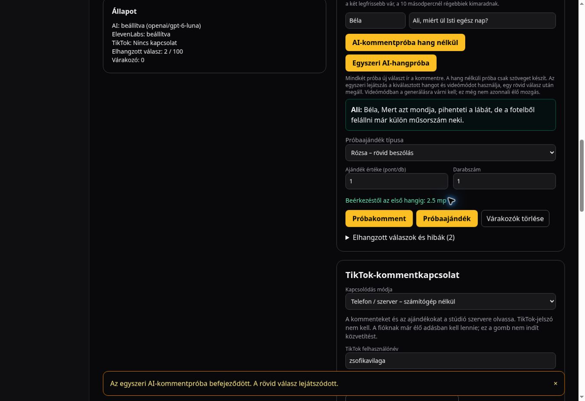

# Incremental live replies and gift interruption

The previous production trace spent 5,274 ms in the model request before starting
speech. The new `Accept: application/x-ndjson` path streams complete, validated
Hungarian sentences from the model into a single ElevenLabs WebSocket session.
The same request carries turn metadata, incremental MP3 chunks and the final
dialogue. The original response contract remains available for older clients.

The selected speaker and name are deterministic. Existing coherence, repetition,
length and unrelated-pizza checks still apply. No partial words, hidden reasoning,
JSON framing or generic filler are spoken. An invalid reply can be repaired once
only before any speech was submitted. There is no repair/replay after speech starts.

The first production test with GPT-6.1 Sol priority still took 6.8 seconds to
audible playback (first sentence 5,240 ms; audio 5,363 ms). The streamed path
was tested with GPT-5.4 Mini (3.5 seconds initially, 2.5 after infrastructure
changes), then moved to GPT-6 Luna because Mini produced an awkward Hungarian
punchline in the final test. Luna uses reasoning disabled and priority service. The
same character, humor and validation rules are retained. Actual service tier,
preflight, first-text timing and token usage are logged. Current catalog prices
(2026-10-14) including the regional premium are at most $0.275/M cache writes
and $1.10/M output.
The 8,000-byte input ceiling plus framing and at most 800 output tokens fit the
existing $0.06 reservation. Oldest history entries are removed if necessary; the
current comment and character rules are never truncated. Non-streaming calls keep
GPT-6.1 Sol and the standard tier. Daily budget/authentication/origin checks remain in place.

Speech connection setup overlaps model preparation. A ready gift's video and
local sound effects start before freshly generated donor speech. The saved
10–199 point begging voice still uses local playback. During preparation the
same model request continues while up to two gifts play. During comment playback
a gift cancels the comment, waits for cleanup, then runs next without overlapping
voices or regenerating the interrupted reply. Interrupted replies count towards
the show's response limit. Already-running gift scenes finish normally.

The displayed first-audio latency now starts when an event enters the browser
queue, including queue wait. It does not claim to measure TikTok broadcast delay.
Server logs separately report first complete sentence, first audio bytes and
total processing time. Browser playback and real TikTok delivery are separate
verification steps.

The Mini production test reached audible playback at 3.5 seconds, but preflight
alone took 1,352 ms. Runtime logs placed the function in Cleveland while the
existing Supabase project is in Tokyo (ap-northeast-1). The respond and streamed
speech functions request hnd1 in deployment configuration, close to the database,
without caching or skipping authentication or budget checks. Runtime log labels
still report cle1, so the observed improvement cannot be attributed to a verified
physical region change. Request cancellation is
enabled on these paths so a stopped/interrupted client also aborts upstream work.
Only these two exact POST paths omit the duplicate middleware getUser round trip;
their own access(request, true) still validates the current user, studio role and
same-site origin before any paid operation. Other routes/methods retain middleware
authentication. Tests cover unauthenticated, forbidden and cross-origin streams.

## Production verification, 2026-10-14

Code commit: `72c931d8534236627fd6146724553fd46ec7b45a`.
Production deployment: `dpl_4WecTjKiky7rJjVtw3vNkVNCfchi` (READY).

| Case | Browser event/click to first audible playback |
| --- | --- |
| Fresh Luna comment, Ali / sulking question | 2.3 seconds |
| Fresh Luna comment, Ali / sitting question | 2.5 seconds |
| 10-point saved begging reaction while comment prepares | 0.1 seconds |
| 1-point rose with freshly voiced donor name | 1.1 seconds |

The last two comment traces reported first audio bytes at 1,392 / 1,590 ms,
preflight at 150 / 144 ms, priority service and zero reasoning tokens. These
two samples do not establish a percentile or a latency guarantee. The comment
goal of near-instant playback is only partially achieved; it is still over two
seconds end-to-end in this browser. A real phone-to-TikTok-to-viewer broadcast
was not started or measured. Gift playback can also delay a queued comment.

Seventy targeted tests passed across eleven files, including auth/origin checks,
budget failures, partial streams, cancellation, gift priority and prerecorded
gift preload. The final model configuration's eighteen relevant tests were rerun
successfully. TypeScript and production builds passed. All browser trials were
stopped afterwards; TikTok remained disconnected.

